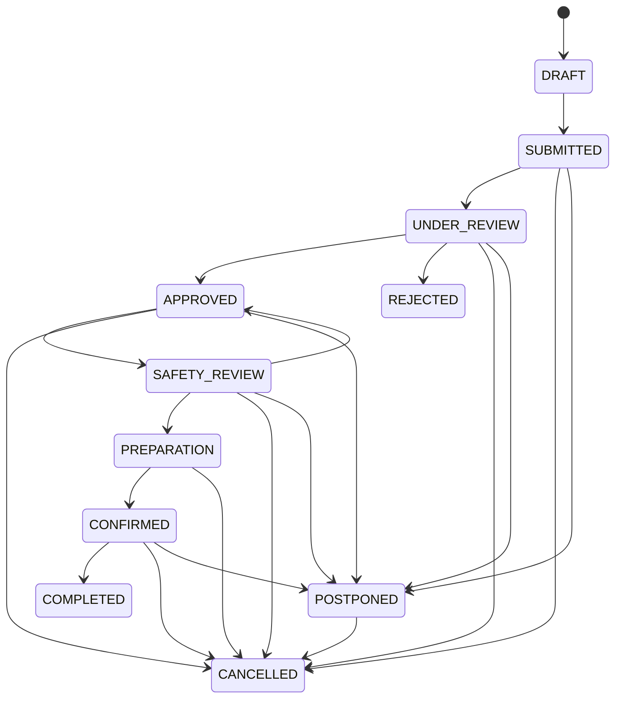

# Event Requests — Sprint 1 scope

> See [the integration guide](event-request-integration.md) for shared
> authentication, `/events/new`, runtime configuration and test commands.

## Scrum tickets

| ID | User story |
| --- | --- |
| Scrum-23 | As an Event Organiser, I want to create an event request containing the information ConnectSphere needs so that my event can be planned. |
| Scrum-25 | As an Event Organiser, I want to submit my event request so that it can be assigned to an Event Coordinator. |

Acceptance criteria Scrum-44 to Scrum-47 sit under Scrum-23; Scrum-49 to
Scrum-51 sit under Scrum-25. Epic Scrum-7.

### Scrum-23 — Create an event request

- An Event Organiser can provide the event name, purpose and description.
- The Organiser can provide the proposed date and time and the expected attendance.
- The Organiser can optionally set when registration opens and closes.
- The Organiser can provide venue requirements and accessibility needs.
- The Organiser can provide equipment and registration needs where relevant.

### Scrum-25 — Submit the event request

- A submitted request is stored and is not treated as a draft.
- The submitted request becomes available for coordinator assignment and subsequent review.
- The event status reflects that the request has been submitted.

The form can still submit directly to `SUBMITTED` in one action. Since SCRUM-147 it can also save a private
draft (`DRAFT`) and submit it later; see *Draft event requests (SCRUM-147)* below.

---

## Role-scoped review and planning

Organisers see their own requests and view-only requests from their client organisation
(SCRUM-100); they can edit only their own event details. Coordinators see only their assigned active
events and the requests they rejected. Managers assign and reassign coordinators but do not decide: the assigned
coordinator approves or rejects (SCRUM-98/99). Venue and equipment arrangements
need an approved event. Only attendees can browse the registration catalogue.
See [event access](event-access.md) for the complete workflow and API contract.

## Database

The `events` table. There is no migration file for this table; it is maintained
in the Supabase dashboard and shared by the Venue, Equipment, Registration and
Assignment features.

```sql
create table events (
  id                  uuid primary key default gen_random_uuid(),
  name                text not null,
  purpose             text,
  description         text,
  start_time          timestamptz,
  end_time            timestamptz,
  registration_start  timestamptz, -- optional registration opening time
  registration_end    timestamptz, -- optional registration closing time
  expected_attendance integer,
  venue_requirements  text,        -- free text; read by the venue feature
  accessibility_needs text,
  equipment_needs     text,        -- free text; read by the equipment feature
  other_comments      text,
  registration_fields jsonb,       -- owned by the registration feature
  status              text not null default 'DRAFT',
  organiser_id        uuid not null,
  coordinator_id      uuid,        -- set by coordinator assignment
  submitted_at        timestamptz,
  approved_rejected_by      uuid,        -- SCRUM-98/99: coordinator who approved or rejected
  approved_rejected_at      timestamptz, -- SCRUM-98/99: when
  approval_rejection_remark text,        -- SCRUM-98/99: required on reject, optional on approve
  created_at          timestamptz not null default now()
);
```

### Status values

SCRUM-97 defines the statuses and the permitted moves between them in
`backend/src/modules/events/lifecycle.js`; SCRUM-139 adds `SAFETY_REVIEW`, SCRUM-149 adds `POSTPONED` and SCRUM-141
implements `PREPARATION` (already allowed by the live constraint, so no status SQL was needed). The
live `events_status_check` constraint was changed by hand in the Supabase
dashboard (no migration file): the eight SCRUM-97 statuses on 2026-09-27,
`SAFETY_REVIEW` on 2026-10-08, and `POSTPONED` with `PREPARATION` kept as already live, with:


**For whoever lands `SAFETY_REVIEW` (or `PREPARATION`) next — a merge checklist.** `lifecycle.js`,
`EventReviewControls.jsx` and `StatusBadge.jsx` will merge **cleanly** with SCRUM-149's changes here — each side
only adds about one line per file, so git won't raise a conflict. That's the trap: a clean merge is not the same
as correct behaviour. Specifically, go through these by hand, because nothing will flag a miss automatically:

1. Decide whether the new status belongs in `ACTIVE_STATUSES` (counts toward a coordinator's workload, stays
   reassignable, stays reachable by Cancel — `POSTPONED` was added here for exactly these reasons).
2. Decide separately whether it belongs in `POSTPONABLE_STATUSES`. The integrated backend already includes
   `SAFETY_REVIEW`; the frontend action lists now match that existing server rule. Confirm any future status
   with the PO before adding it.
3. Add it to the three frontend copies of these lists if the above say yes: `EventCancelControl.jsx` (mirrors
   `ACTIVE_STATUSES`), `EventReviewControls.jsx` (same), `EventPostponeControl.jsx` (mirrors
   `POSTPONABLE_STATUSES`).
4. Add your own transition edges to `TRANSITIONS` and your own row to the table and diagram below.
5. Re-run the whole backend and frontend suite after merging, not just each branch's own tests — a clean merge
   can still leave the combined behaviour wrong in ways neither branch's tests alone would catch.



| Status | Badge label | Set by today |
| --- | --- | --- |
| `DRAFT` | Draft | `createDraft`, when an organiser saves a draft (SCRUM-147) |
| `SUBMITTED` | Submitted | `createSubmitted`, at insert; `markSubmitted`, when a draft is submitted (SCRUM-147) |
| `UNDER_REVIEW` | Under review | the assigned coordinator's *Start review* (SCRUM-98) |
| `APPROVED` | Approved – planning | the assigned coordinator's *Approve* (SCRUM-99), *Withdraw from safety check* (SCRUM-139), or a Safety Officer's *Reject* (SCRUM-141); read by registration and venue |
| `SAFETY_REVIEW` | Safety review | the assigned coordinator's *Submit for safety check* (SCRUM-139); not open to new venue or equipment requests |
| `PREPARATION` | Preparation | a Safety Officer's *Approve* (SCRUM-141); active (workload, reassignable, cancellable) but not a planning status, so arrangements stay locked; not postponable; the assigned coordinator's *Confirm event* moves it on (SCRUM-144) |
| `CONFIRMED` | Confirmed | the assigned coordinator's *Confirm event* (SCRUM-144), only from `PREPARATION` and only with nothing essential outstanding; still a planning status (see *Current limitations*) |
| `COMPLETED` | Completed | not yet (complete story) |
| `CANCELLED` | Cancelled | the assigned coordinator's or the coordinator lead's *Cancel event* (SCRUM-148) |
| `REJECTED` | Rejected | the assigned coordinator's *Reject* (SCRUM-98) |
| `POSTPONED` | Postponed | the assigned coordinator's or the coordinator lead's *Postpone event* (SCRUM-149); still cancellable, still counts toward workload, still reassignable (`ACTIVE_STATUSES`) |

`COMPLETED` and `REJECTED` are fully terminal. `CANCELLED` is terminal too. `POSTPONED` has exactly one way
forward — Cancel — until a future "reschedule" story adds a path back to an active stage. Any move not on the
diagram is refused. After submission, `status` is written only by
`events.repository.js#transitionStatus(id, from, to, extra)` (single-status moves), or by `cancel`/`postpone`
(each reachable from several statuses at once, so they filter with `.in("status", …)` instead of one `.eq(...)`).
Every one of these checks `canTransition` or its own status list, then updates with the matching status filter,
so a caller that loses a race gets `null` (answer 409) and never overwrites. Stored values are not labels; labels
live in `StatusBadge.jsx`. Test cases, traceability and coverage are in
[Event lifecycle tests](event-lifecycle-tests.md).

### Fields the client cannot set

`events.repository.js` writes only the columns in `WRITABLE_COLS`:

```
name · purpose · description · start_time · end_time · registration_start · registration_end · expected_attendance
venue_requirements · accessibility_needs · equipment_needs · other_comments
```

Everything else is set by the server or the database and cannot be influenced by
the request body. A key outside the list is dropped rather than rejected, so
adding a column elsewhere cannot break submissions and a client cannot smuggle
one in.

| Column | Set by |
| --- | --- |
| `id` | database default |
| `status` | `createSubmitted`, always `SUBMITTED` |
| `submitted_at` | `createSubmitted`, server clock |
| `organiser_id` | the controller, from the verified session |
| `coordinator_id` | coordinator assignment — see [Coordinator assignment](event-assignment.md) |
| `approved_rejected_by`, `approved_rejected_at`, `approval_rejection_remark` | the review actions (§Review and approval), from the verified session and server clock |
| `cancelled_by`, `cancelled_at`, `cancellation_reason` | the cancel action (§Cancelling an event), from the verified session and server clock |
| `postponed_by`, `postponed_at`, `postponement_reason` | the postpone action (§Postponing an event), from the verified session and server clock |
| `created_at` | database default |
| `registration_fields` | the registration feature |

Keep `WRITABLE_COLS` and the schema above in step: change one, change the other.
`registration_start` and `registration_end` are optional, client-supplied event
fields written from the explicit allowlist.

---

## Backend

Module at `backend/src/modules/events/`.

| File | Description |
| --- | --- |
| `events.validation.js` | `validateForSubmission` — the submission gate; `validateDraft` — the draft gate (name only) |
| `events.service.js` | Normalisation: trim, blank to `null`, date parse to ISO, integer attendance; `saveDraft`, `updateDraft`, `submitDraft` (SCRUM-147) |
| `events.repository.js` | `createSubmitted` — writes through an explicit column list; the owner-scoped draft queries `createDraft`, `findOwnDrafts`, `findOwnDraft`, `updateDraft`, `markSubmitted` |
| `drafts.controller.js` | SCRUM-147: HTTP mapping for `/api/events/drafts` (400 / 404 / 409 / 500 / 503) |

### Routes

| Method | Path | Auth | Description |
| --- | --- | --- | --- |
| POST | /api/events | requireAuth + events.submit | Create and submit an event request |
| POST | /api/events/drafts | requireAuth + events.submit | SCRUM-147: save a new draft; only `name` required → 201 `{ event }` |
| GET | /api/events/drafts | same | The caller's own drafts, newest first → `{ drafts[] }` |
| GET | /api/events/drafts/:id | same (own draft only) | → `{ event }`; 404 for anyone else's draft or a submitted one |
| PATCH | /api/events/drafts/:id | same | Save edits; body = any editable fields; clearing `name` → 400 |
| POST | /api/events/drafts/:id/submit | same | `DRAFT → SUBMITTED`; body = the form's latest fields; full submission rules → 400 with every missing field, draft unchanged |
| POST | /api/internal/events/:eventId/start-review | requireAuth + internal.access + events.decide (assigned coordinator) | `SUBMITTED → UNDER_REVIEW` |
| POST | /api/internal/events/:eventId/approve | same | `UNDER_REVIEW → APPROVED`; body `{ "note"?: string }` |
| POST | /api/internal/events/:eventId/reject | same | `UNDER_REVIEW → REJECTED`; body `{ "note": string }` (required) |
| GET | /api/internal/events/:eventId/safety-readiness | requireAuth + internal.access + events.safety.submit (assigned coordinator) | `{ ready, missing[], optional[] }` (SCRUM-144 adds `optional` and item ids) |
| POST | /api/internal/events/:eventId/submit-safety-check | same | `APPROVED → SAFETY_REVIEW` when nothing is missing |
| POST | /api/internal/events/:eventId/withdraw-safety-check | same | `SAFETY_REVIEW → APPROVED` |
| POST | /api/internal/events/:eventId/confirm | requireAuth + internal.access + events.decide (assigned coordinator) | `PREPARATION → CONFIRMED` when nothing essential is outstanding (SCRUM-144) |
| PATCH | /api/internal/events/:eventId/arrangements/:kind/:requestId | same | `kind` is `venue` or `equipment`; body `{ "is_essential": boolean }`; only while `APPROVED` or `PREPARATION` (SCRUM-144) |
| GET | /api/internal/safety-reviews | requireAuth + internal.access + events.safety.read (any Safety Officer) | `{ events[] }` awaiting safety review, soonest start first |
| GET | /api/internal/safety-reviews/:eventId | same | `{ event, venues[], equipment[] }`; 404 unless the event is `SAFETY_REVIEW` |
| POST | /api/internal/events/:eventId/cancel | requireAuth + internal.access + events.cancel (assigned coordinator or coordinator lead) | any active status (including `POSTPONED`) `→ CANCELLED`; body `{ "reason": string }` (required) |
| POST | /api/internal/events/:eventId/postpone | requireAuth + internal.access + events.postpone (assigned coordinator or coordinator lead) | any of the five postponable stages `→ POSTPONED`; body `{ "reason": string }` (required) |

### Rules enforced server-side

- Every field problem is returned at once, each named by its column, so a form
  can index its inputs by field name.
- `status` is always set to `SUBMITTED` by the server, and `submitted_at` to the
  server clock. Neither can be supplied by the caller.
- `organiser_id` comes from the verified session, never from the body.
- One mistake yields one message. A value that cannot be parsed is reported once
  with its parse error, and the "required" message for that field is dropped.
- `end_time` is checked only against `start_time`. An end after a future start is
  necessarily in the future itself.
- A request either inserts one complete row or inserts nothing. There is no
  partial success.

### Review and approval (SCRUM-98, SCRUM-99)

`review.service.js`, `review.controller.js`, `routes/review.routes.js`. Only the
event's **assigned coordinator** may act (discussions #80, #101); the Operations
Manager assigns but does not decide. Assignment leaves the event `SUBMITTED`;
review begins when the coordinator clicks *Start review* (#95).

- `events.decide` is a `record: true` permission. The record check loads the
  event and requires `coordinator_id` to be the caller. Someone else's event,
  an unknown id and a malformed id all get the same 403, so existence is not
  revealed.
- Each action is one conditional update through `transitionStatus`, filtered on
  the expected status **and** `coordinator_id`. If the event moved on or was
  reassigned in between, nothing is written and the answer is 409.
- Approve and reject record `approved_rejected_by` (the caller), `approved_rejected_at` (server
  clock) and `approval_rejection_remark` (trimmed; blank is stored as `null`). `approved_rejected_by`
  is kept apart from `coordinator_id` so a later reassignment does not rewrite
  who decided (#94).
- Approval writes nothing else: no venue booking, equipment request or
  registration change (SCRUM-99 AC2).
- `REJECTED` is final; there is no resubmission (#67, team proposal).

**Decision shown to users (SCRUM-99 AC3).** The event workspace detail read
(`GET /api/event-workspace/{organiser,coordinator,manager}/:id`, see
[event access](event-access.md)) returns `approved_rejected_by`, `approved_rejected_at`,
`approval_rejection_remark` and `approved_rejected_by_name`. The responsible organiser, the
assigned coordinator and the manager can load the event (#125), and so can view-only colleagues
in the organiser's client organisation (SCRUM-100). Those colleagues see the full decision,
including the remark; the team agreed this on 2026-10-05. Anyone else gets 404. `approved_rejected_by_name` is the approver's trimmed full name, else their
email. It is `null` when nothing is decided yet, and also when the approver's
account no longer exists or the lookup fails: the event still loads. List reads
do not include the name. The coordinator's scope includes their `REJECTED`
requests so the deciding coordinator keeps seeing the outcome they recorded;
workload counts and reassignment still use only active statuses.

**In the browser.** On *My assigned events → event*, the assigned coordinator
sees *Start review* on a `SUBMITTED` event. On an `UNDER_REVIEW` event they see a
*Decision note* box with *Approve* and *Reject*: a reason is required to reject
(checked in the browser and again on the server), the note is optional to
approve, and the page says approval books nothing. Both buttons are disabled
while a decision is being sent. After a decision the page reloads and shows the
*Review decision* summary (outcome, decided by, decided on, note or reason) to
the organiser, the assigned coordinator and the manager. Status appears as a
`StatusBadge` on the workspace list and detail pages. Hiding the buttons is
convenience only; the server checks the assignment on every action.

| Status | When | Message |
| --- | --- | --- |
| 200 | Done | `{ event }`, the updated row |
| 400 | Reject without a reason | "Give a reason for rejecting this request." |
| 400 | Approval note that is not text | "The note must be text." |
| 401 | No or invalid session | "Please sign in to continue." |
| 403 | Not a coordinator, or not this event's coordinator | "You do not have permission to access this information." |
| 404 | Event deleted after the access check | "That event request no longer exists." |
| 409 | Wrong status, or reassigned meanwhile | "This event request has changed since you opened it. Refresh to see its current status." |
| 503 | The access check could not reach storage | "Unable to check access. Please try again." |

**Schema reference.** The three decision columns are added by hand in the
Supabase SQL editor (no migration file):

```sql
alter table public.events
  add column if not exists approved_rejected_by uuid,
  add column if not exists approved_rejected_at timestamptz,
  add column if not exists approval_rejection_remark text;
```

### Submit for the Operational Safety Check (SCRUM-139)

`safetyReadiness.js` (the rule), `safetyCheck.service.js`, `safetyCheck.controller.js`,
`routes/safetyCheck.routes.js`, `events.repository.js#findArrangements`. Like review, only the
event's **assigned coordinator** may act: `events.safety.submit` is a `record: true` permission and
reuses `review.routes.js#assignedToCaller`.

- **Ready** means nothing essential is missing. Since SCRUM-144 a request its coordinator marked non-essential
  (`is_essential = false`) is listed under `optional` instead and does not block; see SCRUM-144 below.
  - Venue: at least one booking request is booked, meaning every slot that isn't `cancelled` is
    `confirmed`. A request with a `pending` slot is missing ("Waiting for Venue Staff to decide.").
    Fully rejected or cancelled requests are ignored. With nothing booked and nothing pending, the
    item is "No venue booking has been approved yet."
  - Equipment: every request must be `APPROVED`. `PENDING` and `REJECTED` are missing; `RELEASED`
    is ignored. No equipment requests at all is ready.
- `findArrangements` only reads `venue_booking_requests` (+ `venues`, `venue_bookings`) and
  `equipment_requests` (+ `equipment`). The one write to those lanes' tables is SCRUM-144's `is_essential` flag.
- Submit re-runs the rule on the server. Not ready: 409 with `missing`, nothing written. Ready:
  one conditional `transitionStatus` filtered on `APPROVED` and the caller, so a race is a 409.
- AC4: `SAFETY_REVIEW` is not in `PLANNING_STATUSES`, so the venue and equipment lanes' existing
  checks refuse new requests until the coordinator withdraws (`SAFETY_REVIEW → APPROVED`).
- No activity history is written; SCRUM-141 adds it (discussion #33: history is optional in
  Release 1).
- Page: `SafetyCheckControls.jsx` (with `safetyService.js`) on `/assigned-events/:eventId`, shown
  only to the assigned coordinator. On an `APPROVED` event it lists what is missing, with *Check
  again*, and enables *Submit for safety check* once nothing is. On a `SAFETY_REVIEW` event it
  explains the lock and offers *Withdraw from safety check*. The *Arrange venue bookings* and
  *Arrange equipment* links show only for `APPROVED` and `CONFIRMED`, so they disappear during
  review.

| Status | When | Message |
| --- | --- | --- |
| 200 | Done | readiness `{ ready, missing }`; submit / withdraw `{ event }` |
| 401 | No or invalid session | "Please sign in to continue." |
| 403 | Not a coordinator, or not this event's coordinator | "You do not have permission to access this information." |
| 404 | Event deleted after the access check | "That event no longer exists." |
| 409 | Arrangements missing | "This event is not ready for the safety check. Finish the arrangements listed." plus `missing: [{ kind, id, label, reason }]` (`id` absent on "No venue booking…") |
| 409 | Wrong status, or reassigned meanwhile | "This event has changed since you opened it. Refresh to see its current status." |
| 500 | Reading arrangements failed | "Something went wrong. Please try again." |
| 503 | The access check could not reach storage | "Unable to check access. Please try again." |

### Review an event's safety information (SCRUM-140)

`safetyReview.service.js`, `safetyReview.controller.js`, `routes/safetyReview.routes.js`,
`events.repository.js#findAwaitingSafetyReview`, `#findAwaitingSafetyReviewById` and the shared
`#findArrangements`. Pages: `SafetyReviewListPage.jsx` (`/safety-reviews`) and
`SafetyReviewDetailPage.jsx` (`/safety-reviews/:eventId`), with a *Safety reviews* nav link.

- **Who:** `events.safety.read`, Safety Officer only. Safety Officers are a pool rather than
  assigned per event, so any of them may read any event awaiting review and there is no record
  check. It is a `*.read` permission, so `requirePermission` refuses every method but GET/HEAD
  (AC4: view, not edit). The officer holds no write permission anywhere.
- **List (AC1):** `status = SAFETY_REVIEW`, soonest `start_time` first. Columns: id, name, start,
  end, expected attendance.
- **Detail (AC2–AC3):** only while the event is `SAFETY_REVIEW` (otherwise 404, so a withdrawn
  event leaves the queue). The event's columns are an allow-list with no organiser, coordinator or
  registration fields (discussion #45 as guidance). Arrangements use SCRUM-139's meaning of
  *confirmed*: venue requests that `safetyReadiness.js#venueState` calls booked (each shown as its
  own section with only its `confirmed` slots), and `APPROVED` equipment.
- **AC2 field mapping (no schema change, agreed 2026-10-14):**

  | AC2 item | Shown from |
  | --- | --- |
  | Attendance | `events.expected_attendance`; per venue `venue_booking_requests.expected_attendees` |
  | Venue capacity | `venues.capacity`, per venue |
  | Layout | `venue_booking_requests.room_layout`, per venue |
  | Accessibility | `events.accessibility_needs`; per venue the request's `accessibility_requirements` and the venue's `accessibility_features` |
  | Emergency access, venue restrictions | `venues.notes`, labelled *Emergency access and restrictions (venue notes)* |
  | Equipment placement | each reserved item's `equipment_requests.technical_requirement` |
  | Crowd movement | `events.other_comments`, labelled *Crowd movement (organiser's comments)* |

  Empty values show *Not provided*. Dedicated columns would need a form for someone to fill them
  in, which no story covers yet.
- Approving or rejecting the safety arrangement is SCRUM-141 (next section).

| Status | When | Message |
| --- | --- | --- |
| 200 | Done | list `{ events }`; detail `{ event, venues, equipment }` |
| 400 | Event id is not a UUID | "That event reference is not valid." |
| 401 | No or invalid session | "Please sign in to continue." |
| 403 | Not a Safety Officer, or any non-GET method | "You do not have permission to access this information." |
| 404 | Event unknown or not `SAFETY_REVIEW` | "That event is not waiting for a safety review." |
| 500 | Reading storage failed | "Something went wrong. Please try again." |
| 503 | Event storage not configured | "Safety review is not configured." |

### Approve or reject the safety arrangement (SCRUM-141)

`safetyReview.service.js#approve` / `#reject`, `safetyReview.controller.js`, `routes/safetyReview.routes.js`,
`events.repository.js#recordActivity` and `#undoTransition`; the history read is
`eventWorkspace.service.js#activityFor`. Pages: `SafetyDecisionControls.jsx` on `/safety-reviews/:eventId` and
`EventActivityHistory.jsx` on every event workspace detail page.

- **Who:** `events.safety.decide`, Safety Officer only, no record check (the officer pool again). It is a separate
  write grant; `events.safety.read` still refuses every non-GET, so only the two decision paths accept a POST.
- **Approve (AC1, AC3):** `POST /api/internal/safety-reviews/:eventId/approve`, optional `{ note }`.
  `SAFETY_REVIEW → PREPARATION`, the only edge into `PREPARATION`.
- **Reject (AC1–AC3):** `POST /api/internal/safety-reviews/:eventId/reject`, required `{ reason }` (trimmed text).
  `SAFETY_REVIEW → APPROVED`: the event goes back to planning, the coordinator's arrangements reopen, and it can only
  reach `PREPARATION` by being resubmitted and approved (roadmap decision 4).
- **History (AC4):** each decision writes one append-only `event_activity_log` row: `action` `SAFETY_APPROVED` or
  `SAFETY_REJECTED`, `user_id` the officer, and `details` `{ from_status: "SAFETY_REVIEW", to_status, note }`
  (the note or reason). The status moves
  first with a conditional write, so a lost race (409) writes no row; if the row then fails, `undoTransition` puts
  the status back and the caller gets a 500, so a decision never stands unrecorded.
- **Who sees the history:** the event workspace detail (`GET /api/event-workspace/<scope>/:id`) returns
  `activity`, newest first, to everyone already allowed to see the event (organiser and colleagues, assigned
  coordinator, coordinator lead), flattened to `{ id, action, from_status, to_status, note, created_at }`.
  `user_id` is not returned, so the officer is not named (#45 as guidance).
  A failed history read returns `activity: null` and the page says the history is unavailable; the event still
  loads.
- **Response:** `{ event: { id, status } }` only, so the officer sees no organiser or coordinator details.

| Status | When | Message |
| --- | --- | --- |
| 200 | Decided | `{ event: { id, status } }` |
| 400 | Not a UUID / reject without a reason / approval note not text | "That event reference is not valid." / "Give a reason for rejecting this safety arrangement." / "The note must be text." |
| 401 | No or invalid session | "Please sign in to continue." |
| 403 | Not a Safety Officer | "You do not have permission to access this information." |
| 404 | Unknown event | "That event no longer exists." |
| 409 | Event not (or no longer) `SAFETY_REVIEW` | "This event is no longer waiting for a safety review. Refresh to see its current status." |
| 500 | Storage failed, including the history write (the move is undone) | "Something went wrong. Please try again." |
| 503 | Event storage not configured | "Safety review is not configured." |

**Schema reference.** `event_activity_log` was created by hand in the Supabase SQL editor on 2026-10-18 (no
migration file). Row level security is on with no policies, and only `service_role` (the backend's secret key) may
select or insert, so rows cannot be changed or deleted through the API:

```sql
create table public.event_activity_log (
  id uuid primary key default gen_random_uuid(),
  event_id uuid not null references public.events (id) on delete cascade,
  user_id uuid references auth.users (id),
  action text not null,
  details jsonb not null default '{}'::jsonb,
  created_at timestamptz not null default now()
);

create index event_activity_log_event_idx
  on public.event_activity_log (event_id, created_at desc);

alter table public.event_activity_log enable row level security;

revoke all on public.event_activity_log from public, anon, authenticated;
grant select, insert on public.event_activity_log to service_role;
```

`action` is free text and `details` free-form JSON, so later stories (US-75's history) can add their own actions
and fields without another schema change.

### Confirm an event (SCRUM-144)

`safetyReadiness.js#checkArrangements` (the shared rule), `safetyCheck.service.js#confirm` / `#setEssential`,
`safetyCheck.controller.js`, `routes/safetyCheck.routes.js`, `events.repository.js#setArrangementEssential`.
Pages: `ConfirmEventControls.jsx` and the shared `ArrangementChecklist.jsx` on `/assigned-events/:eventId`.

- **Who:** the event's assigned coordinator, through `events.decide` (the same guard as start review / approve /
  reject), so `permissions.js` is unchanged. Everyone else gets 403.
- **When (AC1):** only from `PREPARATION`, which an event reaches only through the Safety Officer's approval
  (SCRUM-141). `APPROVED → CONFIRMED` was removed from `lifecycle.js`.
- **What blocks (AC1–AC3):** the SCRUM-139 rule, re-run on the server at confirm time. Each essential venue booking
  request still pending is listed on its own line (a booking request is one venue on one date, so a multi-venue
  event has one line per venue still waiting); each essential equipment request not yet `APPROVED` too. At least
  one booked venue is always required. Anything left: 409 with `missing`, nothing written. Otherwise one
  conditional `transitionStatus` from `PREPARATION` filtered on the caller, so a race is a 409.
- **Non-essential (AC4):** `is_essential` on `venue_booking_requests` and `equipment_requests`, default `true`. The
  coordinator decides, with Technical Support where it's equipment (discussions #106, #80), and marks the request
  with *Mark as non-essential* (or back with *Mark as essential*). It can change only while the event is
  `APPROVED` or `PREPARATION`: not during safety review (arrangements are locked) and not once confirmed. A
  non-essential outstanding request is returned under `optional`, does not block, and stays open for its lane to
  finish. It also stops blocking the SCRUM-139 safety check, because both use one rule.
- **Write scope:** `setArrangementEssential` updates only `is_essential`, filtered on both the request id and the
  event id, so a request of another event matches nothing (404). The Venue and Equipment lanes' code and pages are
  unchanged and do not show the flag.

| Status | When | Message |
| --- | --- | --- |
| 200 | Confirmed / flag saved | `{ event }` / `{ arrangement: { id, is_essential } }` |
| 400 | Flag not `true`/`false`, unknown `kind`, or malformed request id | "Choose whether this arrangement is essential." / "That arrangement reference is not valid." |
| 401 | No or invalid session | "Please sign in to continue." |
| 403 | Not this event's assigned coordinator | "You do not have permission to access this information." |
| 404 | Request not part of this event | "That arrangement is not part of this event." |
| 409 | Essential items outstanding | "This event cannot be confirmed yet. Finish the essential arrangements listed." plus `missing` |
| 409 | Not `PREPARATION` (confirm), or reassigned meanwhile | "This event has changed since you opened it. Refresh to see its current status." |
| 409 | Flag changed outside `APPROVED` / `PREPARATION` | "Arrangements can only be marked while the event is in planning or preparation." |
| 500 | Storage failed | "Something went wrong. Please try again." |

**Schema reference.** Added by hand in the Supabase SQL editor on 2026-10-19 (no migration file), after telling the
Venue and Equipment lanes:

```sql
alter table public.venue_booking_requests
  add column if not exists is_essential boolean not null default true;

alter table public.equipment_requests
  add column if not exists is_essential boolean not null default true;
```

Existing rows read as essential, so nothing changed for any event until a coordinator marks a request.

### Cancelling an event (SCRUM-148)

`review.service.js#cancel`, `review.controller.js`, `routes/review.routes.js` (same router as review/approval,
since cancel shares its `/api/internal/events/:eventId` prefix). Either the event's **assigned coordinator** or
the **Event Coordinator Lead** may cancel — unlike review, which is coordinator-only (discussions #80, #101).
SCRUM-142 renames the existing manager role to `event_coordinator_lead` without changing its access.

- `events.cancel` is a `record: true` permission. The coordinator lead passes the record check unconditionally; a
  coordinator must still be `coordinator_id` on the event. Someone else's event, an unknown id and a malformed id
  all get the same 403.
- Cancel has no single "from" status — it is permitted from any of the six active stages (`SUBMITTED`,
  `UNDER_REVIEW`, `APPROVED`, `SAFETY_REVIEW`, `CONFIRMED`, `POSTPONED`; see [Status values](#status-values)), so it uses
  `events.repository.js#cancel(id, extra, coordinatorId?)` rather than `transitionStatus`. The write still filters
  on `.in("status", ACTIVE_STATUSES)` and, when the caller is the coordinator, `coordinator_id`, so a stage change
  or reassignment in between means nothing is written and the answer is 409.
- A reason is required (`cancellation_reason`, trimmed; blank or missing is a 400) — unlike approve's optional
  note, cancel always needs one.
- Records `cancelled_by` (the caller) and `cancelled_at` (server clock), additive to any earlier
  `approved_rejected_*` fields — a previously approved event's decision history and its cancellation are both
  kept, not one overwriting the other.
- Releases what the event was holding, synchronously in the same request: every `APPROVED`/`PENDING`/
  `REVIEW_REQUIRED` equipment request on the event moves to `RELEASED` (SCRUM-150 added `REVIEW_REQUIRED` to this
  set, so a reschedule-flagged request is never left stranded by a later cancellation; see
  `docs/equipment-integration.md`), and every
  `pending`/`confirmed` venue booking on the event's booking request(s) is set to `cancelled` (see
  `docs/venue-integration.md`). Both are optional dependencies on the cancel service — if either is not wired in,
  cancelling still succeeds; the release side effects are simply skipped.

**Cancellation shown to users.** The event workspace detail read also returns `cancelled_by`, `cancelled_at`,
`cancellation_reason` and `cancelled_by_name` (same "name, else email, else `null`" rule as
`approved_rejected_by_name`). The coordinator's and manager's own list scopes now include `CANCELLED`, alongside
`REJECTED` and the active statuses, so a cancelled event does not vanish from either list.

**In the browser.** On an event in any of the six active stages, the assigned coordinator (coordinator scope) or
the Event Coordinator Lead (manager scope) sees a *Cancel event* control with a required reason field. After
cancelling, the page shows a *Cancellation* summary (cancelled by, cancelled on, reason) alongside the existing
*Review decision* summary, if there is one.

| Status | When | Message |
| --- | --- | --- |
| 200 | Done | `{ event }`, the updated row |
| 400 | No reason, or a blank one | "Give a reason for cancelling this event." |
| 401 | No or invalid session | "Please sign in to continue." |
| 403 | Not the assigned coordinator and not the coordinator lead | "You do not have permission to access this information." |
| 404 | Event deleted after the access check | "That event request no longer exists." |
| 409 | Not in an active stage, or reassigned meanwhile | "This event request has changed since you opened it. Refresh to see its current status." |
| 503 | The access check could not reach storage | "Unable to check access. Please try again." |

**Schema reference.** The three cancellation columns are added by hand in the Supabase SQL editor (no migration
file):

```sql
alter table public.events
  add column if not exists cancelled_by uuid,
  add column if not exists cancelled_at timestamptz,
  add column if not exists cancellation_reason text;
```


### Postponing an event (SCRUM-149)

`review.service.js#postpone`, `review.controller.js`, `routes/review.routes.js` — same router and the same shape
as cancel above, for an event whose new date isn't known yet. The two actions are independent: an event can be
postponed, then cancelled outright later (see [Status values](#status-values)); there is no path back from
`POSTPONED` to an active stage yet.

- `events.postpone` is a `record: true` permission, the same assigned-coordinator or Event Coordinator Lead access as `events.cancel` (SCRUM-142).
- Postpone is reachable from the active stages **except** `POSTPONED` itself — it uses
  `events.repository.js#postpone(id, extra, coordinatorId?)`, filtered on `POSTPONABLE_STATUSES`
  (`ACTIVE_STATUSES` minus `POSTPONED`), so an already-postponed event can't be postponed again. `cancel()` is
  unchanged and already reaches `POSTPONED` through the wider `ACTIVE_STATUSES`.
- A reason is required (`postponement_reason`, trimmed; blank or missing is a 400), same rule as cancel's.
- Records `postponed_by` and `postponed_at`, kept in separate columns from `cancelled_by`/`cancelled_at` so an
  event that is postponed and later cancelled keeps both reasons on record rather than one overwriting the other.
- Releases the event's venue bookings and holds, synchronously, by calling the **same**
  `venuesService.releaseBookingsForCancelledEvent(eventId)` cancel uses — unchanged, no new Venue-lane SQL.
  **SCRUM-150:** postpone now also releases the event's equipment reservations, the same way cancel does —
  reusing the exact same `equipmentService.releaseReservationsForEvent(eventId, actorId)` call (renamed from
  `releaseReservationsForCancelledEvent`, since it never actually read `events.status`). Postpone never carries a
  new date, so there is no window left to hold equipment against; see `docs/equipment-integration.md` for the
  full reschedule/postpone equipment handling.
- A postponed event still counts toward its coordinator's workload, is still reassignable to a different
  coordinator, and is still cancellable outright — all because `POSTPONED` is in `ACTIVE_STATUSES`, not because
  postpone's own code does anything special for them.

**Postponement shown to users.** The event workspace detail read also returns `postponed_by`, `postponed_at`,
`postponement_reason` and `postponed_by_name` (same "name, else email, else `null`" rule as `cancelled_by_name`).
No scope-filter change was needed for visibility — `POSTPONED` joining `ACTIVE_STATUSES` already keeps a
postponed event in the coordinator's and manager's own lists.

**In the browser.** On an event in any of the five postponable stages, the assigned coordinator or the Event Coordinator
Lead sees a *Postpone event* control alongside *Cancel event*, with a required reason field. After
postponing, the page shows a *Postponement* summary (postponed by, postponed on, reason) alongside any existing
*Review decision* and *Cancellation* summaries.

| Status | When | Message |
| --- | --- | --- |
| 200 | Done | `{ event }`, the updated row |
| 400 | No reason, or a blank one | "Give a reason for postponing this event." |
| 401 | No or invalid session | "Please sign in to continue." |
| 403 | Not the assigned coordinator and not the coordinator lead | "You do not have permission to access this information." |
| 404 | Event deleted after the access check | "That event request no longer exists." |
| 409 | Not in a postponable stage, or reassigned meanwhile | "This event request has changed since you opened it. Refresh to see its current status." |
| 503 | The access check could not reach storage | "Unable to check access. Please try again." |

### Request

Unknown keys are ignored. Send timestamps as ISO 8601 with a zone — a browser
`datetime-local` input gives a zoneless string, which the server would read in
its own zone and shift the event by the organiser's offset.
`withZonedTimes` in `frontend/src/features/events/eventsService.js` converts in
the browser, where the organiser's zone is known.

```json
{
  "name": "Annual Alumni Homecoming",
  "purpose": "Reconnect alumni with the school and current students",
  "description": "An evening reception with a short programme and dinner.",
  "start_time": "2026-11-14T10:00:00.000Z",
  "end_time": "2026-11-14T18:00:00.000Z",
  "registration_start": "2026-10-15T00:00:00.000Z",
  "registration_end": "2026-11-13T23:59:59.000Z",
  "expected_attendance": 250,
  "venue_requirements": "Theatre-style seating, stage, AV booth",
  "accessibility_needs": "Step-free access, hearing loop",
  "equipment_needs": "2 wireless mics, projector, lectern",
  "other_comments": "Catering handled externally."
}
```

### Responses

`201 Created` returns the full inserted row, which is the same shape read from
the table:

```json
{
  "event": {
    "id": "3f1c8a2e-5d47-4b9a-9c31-7e0a6d2b84f5",
    "name": "Annual Alumni Homecoming",
    "start_time": "2026-11-14T10:00:00+00:00",
    "end_time": "2026-11-14T18:00:00+00:00",
    "registration_start": "2026-10-15T00:00:00+00:00",
    "registration_end": "2026-11-13T23:59:59+00:00",
    "expected_attendance": 250,
    "registration_fields": null,
    "status": "SUBMITTED",
    "organiser_id": "<verified-auth-user-uuid>",
    "coordinator_id": null,
    "submitted_at": "2026-09-17T04:12:55.318+00:00",
    "created_at": "2026-09-17T04:12:55.318+00:00"
  }
}
```

`400 Bad Request` returns every problem at once:

```json
{
  "errors": [
    { "field": "purpose", "message": "required" },
    { "field": "start_time", "message": "must be in the future" },
    { "field": "end_time", "message": "must be after start_time" },
    { "field": "expected_attendance", "message": "must be a whole number greater than zero" }
  ]
}
```

`500 Internal Server Error` returns one generic message; the underlying error is
logged, never returned:

```json
{ "error": "Could not submit the event request. Please try again." }
```

### Validation

Both validators return `{ ok, errors: [{ field, message }] }`. The required-field
set and both length caps are the team's proposal — clarification #82 left them
to us.

| Field | Draft | Submission | Rule |
| --- | --- | --- | --- |
| `name` | required | required | non-empty after trim, ≤ 200 |
| `purpose` | — | required | non-empty after trim, ≤ 2000 |
| `description` | — | required | non-empty after trim, ≤ 2000 |
| `start_time` | — | required | parseable, in the future |
| `end_time` | — | required | parseable, strictly after `start_time` |
| `registration_start` | optional | optional | nullable, parseable date/time |
| `registration_end` | optional | optional | nullable, parseable date/time; when both endpoints are set, strictly after `registration_start` |
| `expected_attendance` | — | required | integer > 0 |
| `venue_requirements`, `accessibility_needs`, `equipment_needs`, `other_comments` | never | never | optional free text, ≤ 2000 |

Order of checks: browser attributes (`required`, `maxLength`, `min="1"`, for
convenience only) → `normalise` in the service → `validateForSubmission` (or `validateDraft` when a draft is
saved). A draft skips the date ordering and registration-window checks too; a value that cannot be parsed is still
refused.
Validation reads and never mutates; trimming and coercion for storage are the
service's job.

### Draft event requests (SCRUM-147)

An organiser can save an unfinished request and come back to it (*Week 4 Project Instructions*, *Draft Event
Requests*). No schema change was needed: `DRAFT` is already an allowed status and only `name`, `status` and
`organiser_id` are `NOT NULL` (see *Database*).

- **Saving (AC1, AC2).** `POST /api/events/drafts` runs `validateDraft`: the name is required and the text caps
  still apply, but nothing else is. A value that cannot be read (an invalid date, attendance `0`) is still
  reported. The server sets `status = 'DRAFT'` and `organiser_id` from the verified session; `submitted_at`
  stays null.
- **Continuing (AC3).** `GET /api/events/drafts` lists the caller's drafts; `GET`/`PATCH /api/events/drafts/:id`
  opens and saves one. The frontend sends the whole form each time, so a cleared field is cleared on the draft.
- **Submitting (AC2, AC3).** `POST /api/events/drafts/:id/submit` checks the stored draft *plus* the body with
  `validateForSubmission`. A refusal writes nothing. A pass writes the edits, `SUBMITTED` and `submitted_at` in one
  conditional update (`status = 'DRAFT'` and the owner), so a draft submitted twice, or changed elsewhere,
  answers 409.
- **Privacy (AC4).** Every draft query filters on `organiser_id = caller` and `status = 'DRAFT'`; someone else's
  draft answers **404 "Draft not found."**, never 403, so its existence is not revealed. The organisation
  workspace (`/api/event-workspace/organiser`, SCRUM-100) excludes `DRAFT` for everyone, the owner included, so
  colleagues never see a draft and the owner has one edit path for it. Coordinator, manager and attendee queries
  already filter by status.
- **Permission.** `events.submit`, the same as submitting; `permissions.js` is unchanged.

Not built: deleting a draft, auto-save, and a retention period (#116: none specified).

---

## Frontend

Feature folder at `frontend/src/features/events/`.

### Pages

| File | Route | Scrum | Description |
| --- | --- | --- | --- |
| `pages/EventRequestPage.jsx` | /events/new, /events/new?draft=`<id>` | 23, 25, 147 | Protected event request form; with `?draft=` it loads and continues that draft |
| `pages/EventWorkspacePage.jsx` | /my-event-requests, /assigned-events, /event-management | 97, 98, 161 | Role-scoped event list with a status badge per event; on /event-management it shows `CoordinatorWorkloadOverview` instead (SCRUM-161) |
| `pages/EventWorkspaceDetailPage.jsx` | the same paths + `/:eventId` | 98, 99 | Event details, the review decision summary, and the assigned coordinator's review controls |

### Components

| File | Used by | Description |
| --- | --- | --- |
| `components/EventRequestForm.jsx` | EventRequestPage | The request form. Displays every server-side error against its own input. SCRUM-147: *Save draft* on new requests, and submitting an opened draft submits that draft. |
| `components/CoordinatorWorkloadOverview.jsx` | EventWorkspacePage (manager) | SCRUM-161: the Lead's table of events (event, status, coordinator) from the existing manager list. Opens on *All active statuses*; coordinator filter (each named coordinator, *Awaiting coordinator*, and *No longer active* for assignments held by someone the directory no longer lists) and status filter (lifecycle order, *All statuses* brings back rejected and cancelled events); *Clear filters*; "N of M events shown". Names come from `GET /api/event-workspace/coordinators`: an unknown id reads *No longer active*, and if the directory fails rows keep *Coordinator assigned*. Unassigned and departed coordinators are highlighted. Filters survive *Refresh events*, which also retries a directory that failed to load |
| `components/DraftList.jsx` | EventWorkspacePage (organiser) | SCRUM-147: *Your drafts*, the organiser's own drafts linking back into the form; loading, empty and error states |
| `components/StatusBadge.jsx` | Event request, assignment and workspace screens | Displays the stored status value as words ("Approved – planning" for `APPROVED`); the labels themselves live in [`statuses.js`](#services) |
| `components/EventDecisionControls.jsx` | EventWorkspaceDetailPage (assigned coordinator only) | *Start review* on `SUBMITTED`; note + *Approve* / *Reject* on `UNDER_REVIEW`; nothing otherwise |
| `components/EventDecisionSummary.jsx` | EventWorkspaceDetailPage (every scope) | Outcome, approver ("Not recorded" when unknown), time, and note or reason; hidden until `approved_rejected_at` is set |
| `components/EventActivityHistory.jsx` | EventWorkspaceDetailPage (every scope) | SCRUM-141: recorded decisions newest first, with the note or rejection reason; empty and unavailable states |
| `components/SafetyDecisionControls.jsx` | SafetyReviewDetailPage (`events.safety.decide`) | SCRUM-141: note + *Approve* / *Reject*; reject needs a reason |
| `components/ArrangementChecklist.jsx` | SafetyCheckControls, ConfirmEventControls | SCRUM-144: missing and non-essential lists, with *Mark as non-essential* / *Mark as essential* per request |
| `components/ConfirmEventControls.jsx` | EventWorkspaceDetailPage (assigned coordinator, `PREPARATION`) | SCRUM-144: readiness, the checklist and *Confirm event*; loading, error and busy states |

### Services

| File | Description |
| --- | --- |
| `eventsService.js` | Submits the request and converts event and registration timestamps to ISO with a zone; `saveDraft`, `updateDraft`, `submitDraft` (SCRUM-147) |
| `eventFormat.js` | Date and reference formatting shared with the assignment screens |
| `reviewService.js` | `startReview`, `approveEvent`, `rejectEvent`: the three review calls; only the note is sent |
| `statuses.js` | `statusLabels`, the words for every `events.status` (used by the badges and the overview's status filter), and `activeStatuses`, which mirrors `ACTIVE_STATUSES` in `backend/src/modules/events/lifecycle.js` (SCRUM-161) |

---

## Integration notes for other features

The `events` table holds no reference back to other features; each owning table
holds its own foreign key.

```sql
create table venue_bookings (
  id       uuid primary key default gen_random_uuid(),
  event_id uuid not null references events (id) on delete cascade,
  venue_id uuid not null
);
```

```js
// Read the event alongside your own row.
const { data, error } = await supabase
  .from("venue_bookings")
  .select("id, venue_id, events!inner ( id, name, start_time, end_time, expected_attendance, status )")
  .eq("event_id", eventId)
  .maybeSingle();
```

```js
// The reverse. Left join, so an event with no booking still returns.
const { data, error } = await supabase
  .from("events")
  .select("id, name, start_time, end_time, status, venue_bookings ( id, venue_id )")
  .eq("status", "SUBMITTED")
  .order("submitted_at", { ascending: true });
```

Seeded registration rows carry `status = 'SUBMITTED'` with a null `submitted_at`,
so a query ordering only by `submitted_at` places them arbitrarily. Order by
`created_at` as a tiebreak for a stable sequence.

| Feature | Reads | Notes |
| --- | --- | --- |
| Venue | `venue_requirements`, `accessibility_needs` | Free text, optional, may be null, capped at 2000 characters. The venue reference lives on the venue side. |
| Equipment | `equipment_needs` | Free text, optional, may be null. Parsing it into structured requests is the equipment feature's work. |
| Registration | `id`, `status`, `registration_fields`, `registration_start`, `registration_end` | `registration_fields` is the registration feature's column; registration windows are set on the event request. |
| Assignment | `status`, `coordinator_id`, `submitted_at` | See [Coordinator assignment](event-assignment.md). |

`venue_requirements` and `equipment_needs` are free text rather than structured
fields in this sprint. Converting them to a room-layout selection or a catalogue
link is a schema change belonging to those features.

A future `GET /api/events` must decide visibility from the caller's role, and a
`?status=` parameter may only narrow within that scope — never widen it.
Otherwise an attendee requesting `?status=SUBMITTED` would read every
organiser's unapproved requests. `roles` is an array; handle a user holding
several.

---

## Acceptance criteria
| Scrum | Done when |
| --- | --- |
| 23 | A signed-in Event Organiser can enter event name, purpose, description, proposed start and end time, optional registration opening and closing times, expected attendance, venue requirements, accessibility needs, equipment needs and other comments. Required fields are validated in the browser and again on the server. Optional fields may be left blank and are stored as null. |
| 25 | Submitting stores one complete row with `status = 'SUBMITTED'` and `submitted_at` set by the server, owned by the signed-in Organiser. The request is then visible to coordinator assignment. An invalid submission returns every problem at once, each against its own field, and creates no row. |
| 98 | The assigned coordinator opens a submitted request and sees everything the organiser supplied; *Start review* moves it to `UNDER_REVIEW`; approve or reject records `approved_rejected_by`, `approved_rejected_at` and the note or reason; any other coordinator or role is refused (403 on actions, 404 on reads) and nothing is written. |
| 147 | A draft saves with only a name; required fields are enforced only on submit; *Your drafts* lists, reopens and submits the organiser's own drafts; anyone else gets 404 and never sees them in a list. Specs: [event request tests](event-request-tests.md) §10. |
| 99 | Approval moves `UNDER_REVIEW → APPROVED`, after which venue and equipment arrangements accept the event (`APPROVED`/`CONFIRMED` only); approval writes only the decision columns; the outcome, approver and time are shown to the organiser, the assigned coordinator and the manager. |

---

## Testing

```sh
npm --prefix backend test
npm --prefix backend run check
npm --prefix frontend run lint
npm --prefix frontend run build
```

[Event request tests](event-request-tests.md) is the full case-by-case record for
SCRUM-23/25; [event lifecycle tests](event-lifecycle-tests.md) §8 covers SCRUM-98/99.

| Layer | File | Covers |
| --- | --- | --- |
| Unit | `tests/unit/events/events.validation.test.js` | Required fields, caps, event and registration-window date ordering, attendance, optional-field handling |
| Unit | `tests/unit/events/events.service.test.js` | Normalisation and the dropped-duplicate-message rule |
| Unit | `tests/unit/events/events.repository.test.js` | That `status`, `submitted_at` and `organiser_id` are set outside `WRITABLE_COLS` |
| Integration | `tests/integration/events.submit.test.js` | The HTTP contract: 201, 400, 500 and the error shape |
| Unit | `tests/unit/events/drafts.{service,repository}.test.js` | SCRUM-147 draft rules and the owner-scoped queries |
| Integration | `tests/integration/events.drafts.test.js` | SCRUM-147 over HTTP: every denied role on all five routes, 400 / 404 / 409 / 500 / 503 |
| Frontend | `pages/EventRequestPage.test.jsx`, `pages/EventWorkspacePage.test.jsx` | SCRUM-147 save, reopen, submit and *Your drafts* |
| Frontend | `pages/EventWorkspacePage.overview.test.jsx` | SCRUM-161 overview: active-by-default table with coordinator names, coordinator and status filters, *Clear filters*, filters kept on refresh, no-match, closed-only and directory-failure states |
| Playwright | `tests/playwright/drafts.{api,browser}.spec.cjs` | SCRUM-147 journeys, including a same-company colleague refused |
| Unit | `tests/unit/events/review.service.test.js` | Review transitions, note rules and the decision columns (SCRUM-98/99) |
| Integration | `tests/integration/events.review.test.js` | Review actions over HTTP: 401 / 403 / 404 / 409 / 400 / 500 / 503 |
| Integration | `tests/integration/eventWorkspace.test.js` | Who sees the request and the decision; approver name boundaries; SCRUM-161's Lead and coordinator scopes |
| Frontend | `features/events/components/EventDecision*.test.jsx`, `pages/EventWorkspaceDetailPage.test.jsx` | Review controls, decision summary and the pages each role sees |
| Playwright | `tests/playwright/event-workspace.{api,browser}.spec.cjs` (`REVIEW-E2E-*`) | Role × action matrix and the submit → assign → review → decide journey |
| Playwright | `tests/playwright/event-workspace.browser.spec.cjs` (`E2E-EVENT-102`) | SCRUM-161 overview in a real browser: coordinator and status filters and *Clear filters* at 375 px, then the detail link |

Test names lead with their Jira key, so the terminal output is the traceability
record. Cases are grouped by the Week 4 five-step method: happy path,
cross-cutting, negative, boundary.

### Manual checks

The database is shared across features. Prefix test rows and delete them
afterwards.

1. Start both apps and open the event request form.
2. Submit a complete, valid request. Expect the success view and the returned uuid.
3. Confirm the row in Supabase: `status = 'SUBMITTED'`, `submitted_at` set,
   `coordinator_id` null, `organiser_id` matching the signed-in Organiser.
4. Submit an empty form. Expect every required field flagged at once and no row created.
5. Submit with an end time before the start time. Expect one error, on `end_time` only.
6. Submit registration times in reverse order. Expect an error on `registration_end`.
7. Enter a local event or registration time and confirm the stored `timestamptz` is the intended instant
   rather than shifted by the organiser's UTC offset.
8. Delete the test rows.

---

## Requirements sources

Customer clarifications are numbered as in the exported discussion list.

| Ref | Link | What it says |
| --- | --- | --- |
| #82 | [discussions/72](https://github.com/SinYang13/IS212-2026/discussions/72) | Mandatory fields "have not been firmed out… do propose what is appropriate", and no requirement on field lengths |
| #42 | [discussions/73](https://github.com/SinYang13/IS212-2026/discussions/73) | "After an event request is submitted, an Event Operations Manager assigns an Event Coordinator" |
| #1 | [discussions/95](https://github.com/SinYang13/IS212-2026/discussions/95) | "No acceptance step, if any issue it will be handled outside the system" |
| #2 | [discussions/94](https://github.com/SinYang13/IS212-2026/discussions/94) | Reassignment is by the Operations Manager and may be assumed already approved |
| #3 | [discussions/93](https://github.com/SinYang13/IS212-2026/discussions/93) | Coordinator choice is "up to Event Operations Manager, they have their own SOP… outside of the system" |
| #15 | [discussions/80](https://github.com/SinYang13/IS212-2026/discussions/80) | Approval means the request holds enough information for planning to proceed |

**Week 4 Project Instructions**, *Event Request Creation*:

> Event Organisers can create and submit event requests containing the
> information needed by ConnectSphere, including the event name, purpose,
> description, proposed date and time, expected attendance, venue requirements,
> accessibility needs, equipment requirements, and registration needs where
> relevant.

The following paragraph, *Draft Event Requests*, is built by SCRUM-147 (Sprint 3).

---

## Current limitations

- Event list and detail endpoints are not implemented here. New read endpoints
  need permission and event-relationship checks before returning protected data.
- The `events_status_check` constraint was widened by hand to the eight
  SCRUM-97 statuses on 2026-09-27, then to eleven on 2026-10-11 (SQL and the merge checklist under *Status
  values*). Since SCRUM-141 the app implements all eleven.
- There is no migration file for `events`. Schema changes are made in the
  Supabase dashboard and need to be reflected in this document in the same
  sitting.
- Start review, approve, reject, cancel and postpone move an event past `SUBMITTED` (SCRUM-98/99/148/149).
  Confirm arrives with SCRUM-144. Complete has no action yet, and resuming a postponed event with a new date
  doesn't either; both arrive with their own stories.
- The decision columns (`approved_rejected_by`, `approved_rejected_at`, `approval_rejection_remark`) must exist
  in the shared database (SQL under *Schema reference*) before review works; the cancellation columns
  (`cancelled_by`, `cancelled_at`, `cancellation_reason`) must exist before cancel works outside the tests; the
  postponement columns (`postponed_by`, `postponed_at`, `postponement_reason`) must exist before postpone works
  outside the tests; the `event_activity_log` table (SCRUM-141 *Schema reference*, created 2026-10-18) must exist before safety decisions
  work: without it every decision is undone with a 500, and event pages say the history is unavailable.
- `PREPARATION`  has no way forward but cancel until SCRUM-144 adds confirmation; it is not postponable until the
  PO agrees it.
- A draft cannot be deleted yet (not in SCRUM-147's AC); the organiser's own drafts also appear on the
  Registration lane's *Managed events* page, which lists every event the caller organises.
- `CONFIRMED` is still in `PLANNING_STATUSES` (SCRUM-99 AC1), so after confirmation the *Arrange* links return and
  the Venue and Equipment lanes accept new requests without another check. Whether a confirmed event should stay
  open to changes is a PO/team question; the change itself would be in this lane (`lifecycle.js` and
  `EventWorkspaceDetailPage.jsx`).
- US-13 has no Jira issue, so `US-13` remains the label in code and tests.


## Returning requests for clarification (SCRUM-117, Task 2)

The assigned Event Coordinator can select **Return for changes** on an UNDER_REVIEW
request. A nonblank decision note is required. The request becomes CHANGES_REQUESTED;
its organiser and coordinator are preserved. The message is shown prominently on the
returned request and retained in its activity history. Existing event read access applies
(including same-company organiser view-only access); raw snapshots and actor IDs are
not added to the workspace response.

POST /api/internal/events/:eventId/request-changes accepts { note } and uses
internal.access plus events.decide with the assigned-coordinator record check. The
server supplies the authenticated coordinator ID. The database RPC locks the event and
checks assignment/status again before saving its 12-field snapshot and status together.
Blank/non-text notes return 400; unauthenticated callers 401; wrong roles/assignments 403;
stale status/assignment 409; write failures a safe 500, matching existing review actions.

Returned requests remain visible and count towards coordinator workload. ACTIVE_STATUSES
includes them for cancellation/workload; ASSIGNABLE_STATUSES excludes them. Assigned
coordinators and leads can cancel or postpone them, with the existing required-reason and
release rules. Venue/equipment planning and attendee registration do not admit this status.
The unassigned queue still requires SUBMITTED plus a null coordinator.

Task 2 implements returning and message display. Task 3 adds notification delivery as
documented below; the completed resubmission slice is described after the UI notes.
The organiser's existing Edit event action still saves details without changing status.

### Schema reference — SCRUM-117 return action

Ryan reported applying this SQL manually before code implementation. The supplied column
and constraint exports establish the schema contract. The agent did not access shared
Supabase or execute this SQL there. The existing event_activity_log table is reused.
The definition below has the same statements and behavior as the supplied SQL, with
formatting condensed. It is installation SQL, not a script to rerun on an installed database.

```sql
begin;
alter table public.events drop constraint events_status_check;
alter table public.events add constraint events_status_check check (status in (
  'DRAFT', 'SUBMITTED', 'UNDER_REVIEW', 'CHANGES_REQUESTED', 'APPROVED',
  'SAFETY_REVIEW', 'PREPARATION', 'CONFIRMED', 'COMPLETED', 'CANCELLED', 'REJECTED', 'POSTPONED'
));
create function public.request_event_changes(p_event_id uuid, p_coordinator_id uuid, p_message text)
returns setof public.events
language plpgsql security invoker set search_path = public
as $$
declare
  v_event public.events%rowtype;
  v_snapshot jsonb;
  v_cycle_id uuid := gen_random_uuid();
begin
  if p_message is null or btrim(p_message) = '' then
    raise exception 'A clarification message is required.' using errcode = '22023';
  end if;
  select * into v_event from public.events where id = p_event_id for update;
  if not found then return; end if;
  if p_coordinator_id is null
     or v_event.coordinator_id is distinct from p_coordinator_id
     or v_event.status <> 'UNDER_REVIEW' then return; end if;
  v_snapshot := jsonb_build_object(
    'name', v_event.name, 'purpose', v_event.purpose, 'description', v_event.description,
    'start_time', v_event.start_time, 'end_time', v_event.end_time,
    'registration_start', v_event.registration_start, 'registration_end', v_event.registration_end,
    'expected_attendance', v_event.expected_attendance, 'venue_requirements', v_event.venue_requirements,
    'accessibility_needs', v_event.accessibility_needs, 'equipment_needs', v_event.equipment_needs,
    'other_comments', v_event.other_comments
  );
  insert into public.event_activity_log(id, event_id, user_id, action, details)
  values (v_cycle_id, v_event.id, p_coordinator_id, 'CHANGES_REQUESTED', jsonb_build_object(
    'cycle_id', v_cycle_id, 'from_status', 'UNDER_REVIEW', 'to_status', 'CHANGES_REQUESTED',
    'note', btrim(p_message), 'organiser_id', v_event.organiser_id,
    'coordinator_id', v_event.coordinator_id, 'before', v_snapshot
  ));
  return query update public.events set status = 'CHANGES_REQUESTED' where id = v_event.id returning *;
end;
$$;
revoke all on function public.request_event_changes(uuid, uuid, text) from public, anon, authenticated;
grant execute on function public.request_event_changes(uuid, uuid, text) to service_role;
commit;
```


### Task 3 — organiser notification

The CHANGES_REQUESTED activity insert now queues an organiser notice through the trigger documented in [notifications](notifications.md#returned-request-notifications--scrum-117-task-3). Message, event name, recipient and link are captured from saved history. Queue failure rolls back the return; provider failure leaves pending work for retry. Existing request visibility applies when opening the link. Ryan reports SQL and Novu workflow setup completed and the return journey working. Formal live UAT results have not been recorded.

### Clarification UI polish

The review form separates Return for changes from Approve/Reject and explains that the organiser receives the message while the coordinator remains assigned. The message field is larger and disabled during saving, with a progress announcement. The organiser's saved feedback appears in a highlighted, wrapping panel with guidance to Edit event. The existing status rules, permissions, endpoints and notification payload are unchanged. The resubmission slice below adds a separate action after saving.

### Resubmission and coordinator changes (SCRUM-117)

The responsible organiser saves edits, then selects **Resubmit request**. Saving alone leaves CHANGES_REQUESTED unchanged. Resubmission sets UNDER_REVIEW and retains coordinator_id; the request never enters the unassigned queue. No-change resubmission is allowed. Rejected requests remain final.

POST /api/event-workspace/organiser/:id/resubmit accepts only { cycleId }, the latest CHANGES_REQUESTED activity ID. It uses events.own.update, owner checking and full submission validation. Invalid payload/details return 400; missing authentication 401; wrong role or same-company non-owner 403; inaccessible event 404; stale status/cycle/saved details 409; dependency failure 503. The server passes all twelve validated saved fields to resubmit_event_request. The locked operation compares them again before changing status, writing REQUEST_RESUBMITTED history and queuing the coordinator notice in one transaction. Failed queue writes roll back; delivery failures remain retryable through the existing worker.

All twelve editable fields are compared with the last submitted/resubmitted snapshot: name, purpose, description, start_time, end_time, registration_start, registration_end, expected_attendance, venue_requirements, accessibility_needs, equipment_needs and other_comments. Timestamp equivalents compare by instant; optional empty/null values compare equally. The stored changes contain field/before/after and remain unchanged by later edits. Only the assigned coordinator workspace returns these comparisons, without raw snapshots or actor identifiers. The latest resubmission is displayed with its timestamp; previous activity remains in history. Workspace reads include registration dates and partial date edits validate against the complete saved registration window.

Exact applied resubmission/queue SQL is in [the notification schema reference](notifications.md#scrum-117-resubmission-schema-reference). Ryan reported applying it and creating event-request-resubmitted on 22 October 2026. The coordinator payload is eventId, cycleId, eventName, changedFieldCount and requestPath; the path is /assigned-events/<eventId>. Live resubmission delivery still requires a manual check after this code is running.

### Saved organiser edits before a return (SCRUM-117 clarification, 24 October 2026)

Saving Edit event now produces a coordinator comparison on refresh/reopen, even before Return for changes. The request status is unchanged. The baseline is captured at initial submission (including draft submission), retained through saves and returns, and advanced only by a successful resubmission. Saving 30 → 45 before a return is therefore still a 30 → 45 change when resubmitted without further edits.

The assigned coordinator response includes request_changes with source, version_at and whitelisted field/before/after entries. Internal REQUEST_BASELINE_RECORDED rows are filtered out of all public activity histories. Organiser and manager responses omit request_changes. The latest historical resubmission comparison remains immutable and is labelled Last resubmission. Current status and coordinator decisions appear above the long details/history area.

Existing requests use the last resubmission snapshot, otherwise the earliest retained return snapshot, otherwise current values at installation. The UI explains limited history for recovered-return/tracking-start baselines. Earlier overwritten values cannot be reconstructed. Legacy resubmission entries keep their original return-time explanation. No event status, edit permission, Novu payload or save-notification rule changed.

Exact applied correction SQL: [saved-edit version baseline schema](notifications.md#scrum-117-saved-edit-version-baseline-schema-reference). Ryan reports successful manual application on 24 October 2026.
